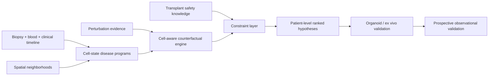

# MOSAIC-Tx

**M**ulti-**O**mic, **S**patially **A**ware **I**ntervention **C**ounterfactuals for
Transplantation.

MOSAIC-Tx is a research framework for prioritizing interventions that may interrupt the
patient-specific, multicellular programs sustaining kidney-allograft injury. It combines
cell-state-resolved molecular effects, perturbation evidence, and transplant-specific safety
constraints. The output is an auditable shortlist for experimental validation—not a treatment
recommendation.

The design was inspired by the general idea of connecting molecular disease states to candidate
interventions, but the scientific question, scoring model, validation ladder, and implementation
here were developed independently. No text or graphical design was copied from the supplied post.

> **Research use only.** This prototype uses synthetic data. It is not a medical device, has not
> been clinically validated, and must not guide patient care or medication changes.

## Why this project

Antibody-mediated rejection (ABMR) is not one bulk expression vector. Endothelium, myeloid cells,
NK cells, B/plasma cells, tubules, and stromal compartments can contribute different—and sometimes
opposing—signals. A drug that reverses an average biopsy signature may miss the causal compartment
or create unacceptable infection, kidney-toxicity, or interaction risk.

MOSAIC-Tx therefore asks:

> For this molecular endotype, which intervention most consistently moves the implicated cell
> states toward a stable-allograft reference while respecting transplant-specific safety constraints?

## What is original in the design

The central unit is a **patient × cell state × mechanism × intervention** counterfactual. The
prototype scores signed perturbation effects only where disease and drug evidence overlap, reports
coverage, preserves uncertainty, and separates molecular rescue from safety penalties. The planned
research system adds spatially weighted cell-cell circuits, donor/recipient context, longitudinal
blood-to-biopsy concordance, causal target triangulation, and prospective validation.

This is a proposed contribution, not a claim of established novelty. A protocol-driven literature
and patent review is an explicit Phase 0 gate; see `docs/novelty_and_landscape.md`.

## Quick start

Requires Python 3.10+ and no runtime dependencies.

```bash
python -m mosaic_tx.cli rank \
  --disease examples/synthetic/disease_signature.csv \
  --perturbations examples/synthetic/perturbations.csv \
  --safety examples/synthetic/safety.csv \
  --output results/demo_rankings.csv \
  --audit results/demo_audit.json

python -m unittest discover -s tests -v
```

## Build the public discovery dataset

```bash
python scripts/build_public_data.py --dataset GSE50084
```

This downloads the official GSE50084 processed matrix, verifies its pinned checksum, and compiles
validated sample and expression tables under gitignored `data/`. See `docs/public_data_pipeline.md`.

The demo data and candidate names are fictional. A higher `priority_score` indicates stronger
predicted reversal after safety penalties; `coverage` reveals how much of the measured disease
state was actually evaluated.

## Architecture



## Repository map

```text
mosaic_tx/                    Dependency-light scoring package
examples/synthetic/           Clearly labeled fictional input data
tests/                        Unit and CLI tests
configs/                      Versioned scoring weights
docs/scientific_protocol.md   Cohorts, endpoints, validation, and statistics
docs/data_contracts.md        Schemas and governance boundaries
docs/collaboration_brief.md   Concrete questions for Prof. Sarwal or another PI
docs/novelty_and_landscape.md Prior-art and novelty-validation plan
docs/model_card.md            Intended use, limitations, and failure modes
.github/workflows/ci.yml      Reproducibility checks
```

## Current status

- [x] Original concept and falsifiable research question
- [x] Auditable reference scoring engine
- [x] Synthetic end-to-end example and tests
- [x] Data contracts, validation plan, model card, and collaboration brief
- [ ] Registered systematic landscape review
- [ ] Curator-approved public discovery cohorts
- [ ] External multi-center validation
- [ ] Ex vivo or organoid perturbation experiments
- [ ] Prospective clinical utility study

## Reproducibility and contributions

All inputs are immutable tables with explicit evidence fields. Every run emits a configuration and
SHA-256 input hashes. See `CONTRIBUTING.md` before proposing a new dataset or scoring component.

## License and citation

Code is MIT licensed. Documentation is also distributed under the MIT license. Cite the repository
using `CITATION.cff`. Clinical datasets retain their original terms and are never redistributed here.

