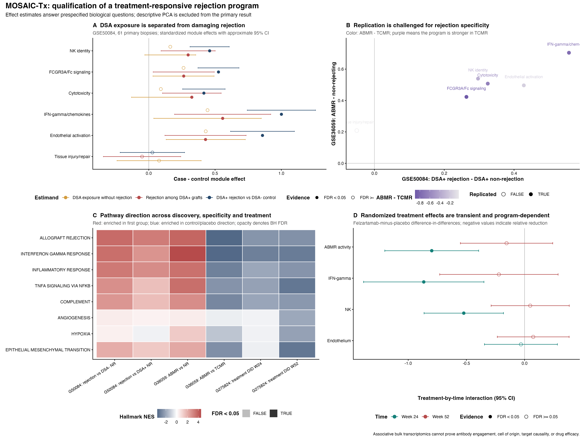

# MOSAIC-Tx

**M**ulticohort **O**mics **S**tudy of **A**ntibody-associated **I**njury and its **C**ourse after
**T**ransplantation.

MOSAIC-Tx is a public-data reanalysis of kidney-allograft antibody-mediated rejection (ABMR). It
asks one biological question:

> Which ABMR expression programs are reproducible, rejection-specific, cell-localizable, and sufficiently robust across reference definitions and treatment states to justify downstream drug-reversal analysis?

This repository does not claim patient-specific treatment prediction, clinical validation, wet-lab
validation, causal target discovery, or validated drug repurposing. It compiles published,
de-identified datasets and tests prespecified contrasts with reproducible statistics.

## Executed primary result

The primary figure answers four prespecified biological questions using effect sizes, confidence intervals, specificity tests, pathway enrichment, and randomized treatment-by-time interactions. It does not use simulated values. The exact plotted estimates are exported as CSV files.



The biopsy-level PCA, distributions, and individual patient trajectories are retained as [descriptive quality-control results](figures/fig6_dataset_results.png), not as the main biological evidence.

Conceptual workflow and mechanism diagrams are retained only as study-design documentation: [evidence design](figures/fig1_study_design.svg), [translational extension](figures/fig2_translational_extension.svg), and [mechanism chain](figures/fig3_mechanism_chain.svg). They are not data figures. The former summary-effect figures are retained for provenance but are not the primary results display.

## Why this question is supported by available data

GSE50084 contains DSA-negative, DSA-positive/no-rejection, and DSA-positive/rejection samples.
GSE36059 supplies a larger independent ABMR/TCMR/non-rejection biopsy cohort. GSE275824 contains
longitudinal randomized placebo/felzartamab biopsies with published ABMR, IFN-gamma, NK-cell and
endothelial molecular scores. E-MTAB-12051 and GSE145927 can localize replicated programs to cell
types, but their modest patient counts preclude cell-level machine-learning claims.

## Verified scope

- [x] Checksum-verified acquisition of three public bulk cohorts
- [x] 589 expression profiles compiled in total
- [x] Platform-specific Bioconductor probe-to-gene annotation
- [x] Moderated differential expression and Hallmark GSEA
- [x] Independent ABMR-versus-non-rejection replication
- [x] ABMR-versus-TCMR specificity analysis
- [x] Patient-blocked randomized treatment-response analysis
- [x] Published-score trajectory analysis
- [ ] Single-cell patient-level pseudobulk localization
- [ ] Cross-cohort effect-size synthesis
- [ ] Externally validated patient-level biomarker model
- [ ] Evidence-qualified drug-signature reversal
- [ ] Target-specific QSAR (only if the activity-data gate passes)

The new single-cell branch is restricted to human NovaSeq 6000 data and builds a canonical Scanpy
`AnnData` object with optional MuData export. Stable allograft, non-rejection injury and native healthy
kidney are separate reference domains. Spatial transcriptomics remains exploratory. Drug reversal,
QSAR, docking and molecular dynamics are downstream gates—not assumed deliverables.

## Start here

1. [`docs/STUDY_BLUEPRINT.md`](docs/STUDY_BLUEPRINT.md) — biological question, estimands, statistical models, figure-to-claim contract, and decision gates
2. [`docs/PROJECT_PLAN.md`](docs/PROJECT_PLAN.md) — question, hypotheses, aims and success criteria
2. [`docs/FEASIBILITY_AUDIT.md`](docs/FEASIBILITY_AUDIT.md) — what is practical on this Mac and what is not
3. [`docs/ANALYSIS_SPECIFICATION.md`](docs/ANALYSIS_SPECIFICATION.md) — frozen contrasts and statistics
4. [`docs/MECHANISM_MAP.md`](docs/MECHANISM_MAP.md) — measurable evidence and falsification at every biological arrow
5. [`docs/RESULTS_SNAPSHOT.md`](docs/RESULTS_SNAPSHOT.md) — verified results and null findings
6. [`docs/LIMITATIONS.md`](docs/LIMITATIONS.md) — claims the data cannot support
7. [`docs/TRANSLATIONAL_EXTENSION.md`](docs/TRANSLATIONAL_EXTENSION.md) — single-cell, ML and drug gates
8. [`docs/DRUG_QSAR_PROTOCOL.md`](docs/DRUG_QSAR_PROTOCOL.md) — chemical-data and QSAR requirements
9. [`docs/PILOT_RESULTS.md`](docs/PILOT_RESULTS.md) — executed findings, null results, and claim boundaries
10. [`docs/CODE_REVIEW.md`](docs/CODE_REVIEW.md) — script-by-script verification status and defects found
11. [`docs/R01AI180118_ALIGNMENT.md`](docs/R01AI180118_ALIGNMENT.md) — contribution to the transplantation program without aim duplication
12. [`docs/PIPELINE_EXECUTION.md`](docs/PIPELINE_EXECUTION.md) — successful one-command run, outputs, checksums, and warnings

## Execute the complete bulk pilot

```bash
scripts/run_three_dataset_pipeline.sh
```

Equivalent stage-by-stage execution:

```bash
make data
make annotate
make bulk
make scores
make pilot
make check
```

The tracked pilot results were generated from the three public cohorts on the local Mac. Single-cell,
ML, drug reversal, QSAR, docking and MD remain gated and are not represented as completed.

## Reproduce verified analyses

```bash
python3 scripts/build_public_data.py --dataset GSE50084
python3 scripts/build_bulk_cohorts.py --dataset GSE36059
python3 scripts/build_bulk_cohorts.py --dataset GSE275824

Rscript scripts/02b_annotate_bioc.R data/processed/GSE50084/expression_probe_matrix.csv.gz data/processed/GSE50084/samples.csv GPL6244 data/processed/GSE50084
Rscript scripts/02b_annotate_bioc.R data/processed/GSE36059/expression_probe_matrix.csv.gz data/processed/GSE36059/samples.csv GPL570 data/processed/GSE36059
Rscript scripts/02b_annotate_bioc.R data/processed/GSE275824/expression_probe_matrix.csv.gz data/processed/GSE275824/samples.csv GPL13667 data/processed/GSE275824

Rscript scripts/03_bulk_de_gsea.R data/processed/GSE50084/gene_expression.csv.gz data/processed/GSE50084/samples.csv results/bulk/GSE50084
Rscript scripts/04_external_validation.R data/processed/GSE36059/gene_expression.csv.gz data/processed/GSE36059/samples.csv results/bulk/GSE36059
Rscript scripts/05_treatment_response.R data/processed/GSE275824/gene_expression.csv.gz data/processed/GSE275824/samples.csv results/bulk/GSE275824
Rscript scripts/06_published_score_trajectories.R data/processed/GSE275824/samples.csv results/bulk/GSE275824

python3 scripts/07_score_mechanism_modules.py --expression data/processed/GSE36059/gene_expression.csv.gz --output results/bulk/GSE36059/mechanism_module_scores.csv

python3 -m unittest discover -s tests -v
```

Generic single-cell entry points (after downloading an eligible study and preparing barcode-level
metadata) are `scripts/10_build_scanpy_object.py`, `scripts/11_sc_qc_cluster.py`, and
`scripts/12_patient_pseudobulk.py`. `scripts/13_grouped_nested_ml.py` accepts only frozen,
patient-level features and keeps patients together during nested validation.

Required R packages are listed in [`environment.yml`](environment.yml). Raw and derived assay files
are gitignored and rebuilt from their public sources. The code is research software, not a medical
device or clinical decision system.
