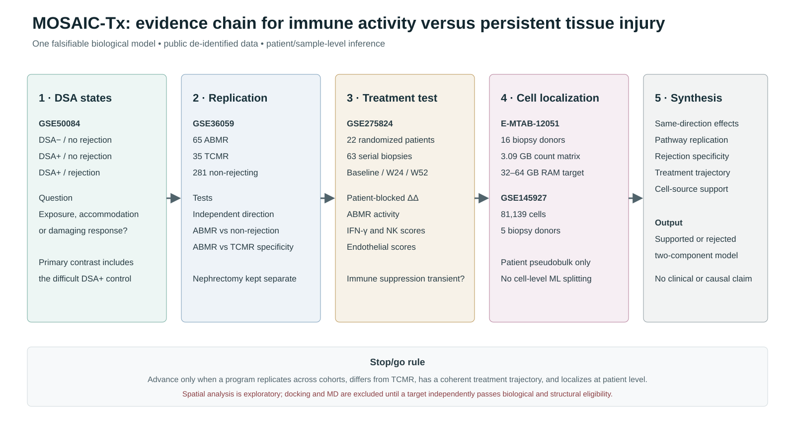

# MOSAIC-Tx project plan

## Working title

**Spatially resolved multicohort analysis identifies persistent, druggable immune–vascular programs in antibody-mediated kidney-allograft injury**

## Central question

Which molecular programs distinguish ABMR from DSA-positive accommodation and TCMR, where do those
programs localize in the graft, which respond to therapy in published longitudinal data, and which
remaining regulators are credible small-molecule targets?

## Hypothesis

Persistent ABMR is sustained by reproducible immune–endothelial and tissue-injury programs that are
measurable in bulk biopsies, attributable to defined cell states, spatially localized, and only
partially suppressed by current treatment. Targets are prioritized only when their direction,
cellular source, spatial context, treatment responsiveness, druggability, and structural evidence
converge.

## Specific aims

### Aim 1 — Establish reproducible ABMR programs

Use GSE50084 for discovery, GSE36059 for independent replication and ABMR-versus-TCMR specificity,
and GSE275824 for patient-blocked treatment-response analysis. Perform platform-specific QC,
authoritative probe annotation, limma models, pathway enrichment, effect-direction concordance and
random-effects meta-analysis. Primary endpoint: replicated gene-set activity with BH FDR control.

### Aim 2 — Resolve cellular and spatial mechanisms

Analyze E-MTAB-12051 and complementary public single-cell cohorts using donor-aware QC, sample-level
pseudobulk statistics and cell-state annotation. Test localization in public spatial datasets rather
than treating spot-level observations as independent patients. Primary endpoint: cross-dataset
concordance of pathway direction in a prespecified cell type or spatial compartment.

### Aim 3 — Prioritize computational intervention hypotheses

Integrate replicated biology with perturbational evidence, target tractability and transplant safety.
Only targets passing biological and structural gates proceed to reference-ligand benchmarking,
ensemble docking and replicated MD. Primary endpoint: a transparent evidence matrix and experimental
shortlist—not a therapeutic recommendation.

## Cohort roles and leakage controls

| Evidence layer | Dataset | Prespecified role | Key restriction |
|---|---|---|---|
| Bulk | GSE50084 | Discovery | DSA-positive/no-rejection remains a distinct difficult control |
| Bulk | GSE36059 | External validation and TCMR specificity | Nephrectomy is separate from stable allograft |
| Intervention | GSE275824 | Longitudinal treatment response | Patient-blocked difference-in-differences |
| Single cell | E-MTAB-12051, GSE145927 | Cell-state localization | Patient, not cell, is the replicate |
| Spatial | GSE252137, GSE280559, GSE284715 | Spatial/cross-species support | ROI/spot is not treated as an independent patient |

No sample may contribute to both model selection and held-out evaluation. Feature selection,
normalization and tuning occur inside training folds. Dataset and center holdouts take precedence
over random cell- or sample-level splits.

## Statistical hierarchy

1. Cohort-specific effect estimation with explicit contrasts.
2. BH false-discovery control within each declared analysis family.
3. Independent direction and pathway replication.
4. Random-effects meta-analysis with heterogeneity statistics.
5. Sensitivity analyses for label definition, reference group and platform.
6. Cell-state pseudobulk and spatial permutation tests at the biological-replicate level.
7. Nested ML evaluation with calibration, uncertainty and negative controls.

Exploratory analyses are labeled separately. Null results remain in the report.

## Target-selection gate

A target proceeds only if it has replicated association, coherent direction, defined cellular source,
spatial support, perturbational evidence, acceptable transplant-safety rationale and a tractable
binding site. A docking score alone is never selection evidence. MD requires pose recovery or a
reference ligand, decoys, multiple seeds and convergence checks.

## Planned principal figures

1. Study design and evidence gates.
2. Cohort QC, contrasts and cross-cohort effect concordance.
3. Replicated pathways and treatment-responsive versus persistent programs.
4. Single-cell atlas with patient-level pseudobulk effects.
5. Spatial localization and neighborhood enrichment.
6. Multimodal evidence graph and calibrated ML evaluation.
7. Target triage, docking controls and replicated MD—only if eligibility gates pass.

## Reporting standard and realistic journal positioning

The work should follow STROBE-style observational reporting, TRIPOD principles for prediction,
FAIR provenance, complete code/data manifests and explicit limitations. With public computational
data alone, a defensible aspirational target is **Nature Communications**, **Communications
Medicine**, **Cell Reports Medicine**, or a strong transplant/bioinformatics journal. **NEJM** or a
primary Nature/Cell research journal is not a credible claim without major prospective clinical or
experimental validation. Journal selection follows completed evidence, not branding.

## Current verified status

The three bulk cohorts, gene annotation, differential expression, Hallmark GSEA, external specificity
analysis and randomized longitudinal analysis run successfully. Single-cell, spatial, meta-analysis,
ML, target convergence, docking and MD remain gated work packages and must not be described as
completed until their scripts, QC and results are verified.
